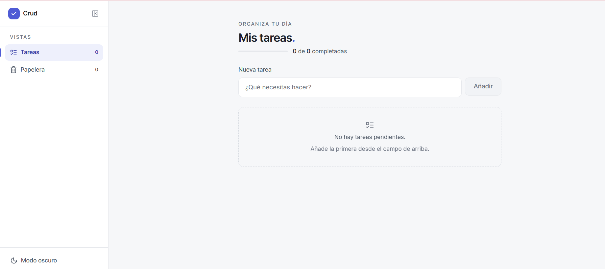

# CRUD - Task Manager

Web application to organize daily activities with a modern, lightweight, and functional interface. This project allows you to create tasks, edit them, mark them as completed, delete them, and recover them [...]

## Project Description

The application works as a personal task manager designed to keep track of pending tasks in one place. Its main flow is based on a CRUD model, where the user can:

- Create new tasks.
- Edit the name of each task inline.
- Mark tasks as completed or pending.
- Delete tasks and send them to the trash.
- Restore deleted items.
- Empty the trash permanently.
- Save information locally in the browser.
- Switch between light and dark mode.

## Preview

## Main Features

- Architecture with Next.js and React.
- User interface focused on productivity and visual clarity.
- Sidebars to navigate between tasks and trash.
- Dynamic count of active tasks.
- Empty state with a friendly message when there are no pending tasks.
- Data persistence using localStorage.
- Light/dark theme with preference saved by the user.
- Responsive design for different screen sizes.
- Smooth animation when deleting tasks.

## Technologies Used

- Next.js 16
- React 19
- TypeScript
- CSS Modules and global CSS
- localStorage for local storage

## Requirements for Operation

Before starting the project, make sure you have installed:

- Node.js 20 or higher
- npm or Bun

## Installation

1. Clone the repository.
2. Go to the project folder.
3. Install the dependencies:

   npm install

   or if you prefer Bun:

   bun install

## Execution

### Development mode

npm run juju

or with Bun:

bun run juju

Then open your browser at:

http://localhost:3000

### Compile for production

npm run build

### Run the compiled version

npm run start

## Relevant Project Configuration

The project does not require a .env file to function in its current state. The main configuration is in these files:

- package.json: scripts and dependencies.
- next.config.ts: general Next.js configuration.
- tsconfig.json: TypeScript configuration and path aliases.
- src/app/globals.css: visual styles of the system and light/dark theme.

The application uses browser local storage to preserve tasks and trash without the need for a backend.

## General Project Structure

- src/app/components: interface components.
- src/app/hooks: reusable logic such as tasks, storage, and trash.
- src/app/types: TypeScript type definitions.
- src/app/icons: reusable icons.

## Team Members

- Esteban Meléndez
- Santiago Torregroza
- Sebastián Torregroza
- Gisell Falcón
- Owen López

## Note

This project is designed as a personal task manager with a simple, clean, and functional browser experience.